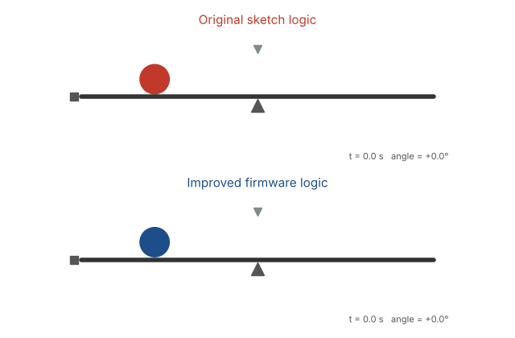
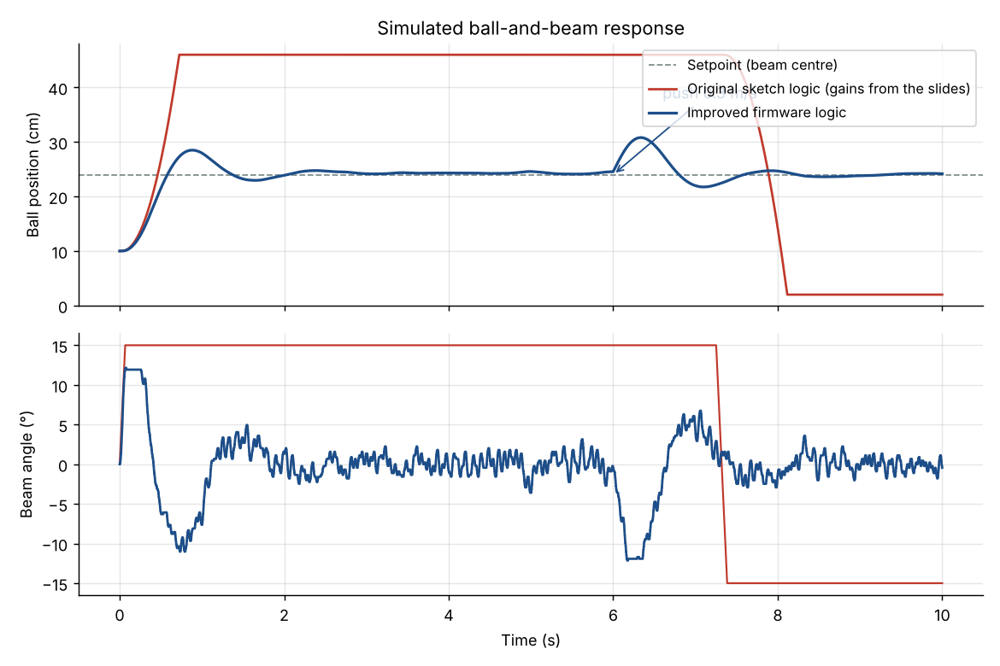
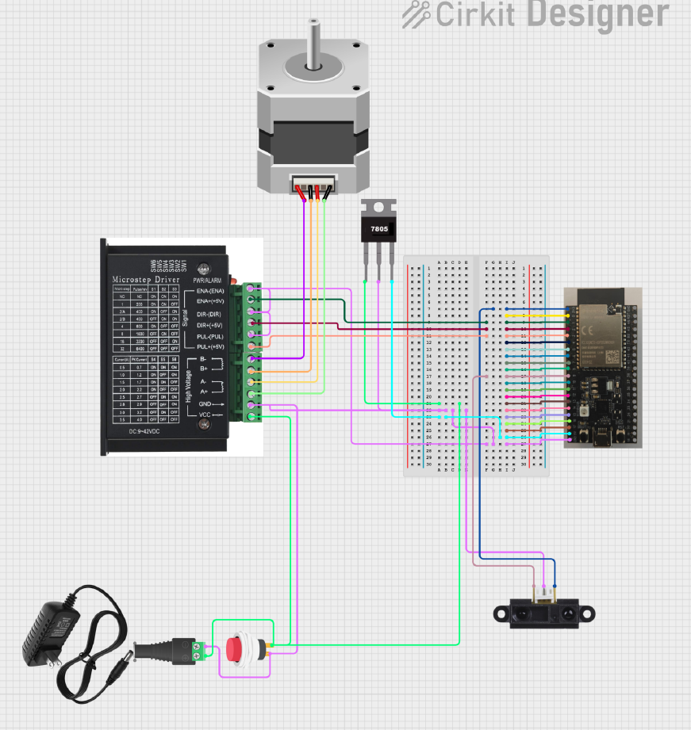

# Ball Balancing on a Beam: ESP32 + PID Control

A classic control-systems project: an ESP32 reads the position of a table-tennis ball on a 48 cm beam with a distance sensor, and a PID controller tilts the beam with a stepper motor to keep the ball at the centre. Built as a team case study at Deggendorf Institute of Technology, from requirements and design through wiring, assembly, firmware and testing.



*Simulation of the original control logic (top) and the improved logic (bottom), using the project's hardware parameters.*

## Project status

The hardware was built and tested: wiring, voltage regulation, the microstep driver and the motor all worked as intended (see the [testing presentation](docs/3_testing.pdf)). In closed loop, the rig **balanced the ball only partly**: it oscillated and held the ball only some of the time.

After the project I analysed why, using a physics simulation of the rig, and wrote an improved firmware. The improved firmware has been verified **in simulation only, not yet on the hardware**.

## Why the original version oscillated

The [original sketch](firmware/original_sketch.ino) has four problems. The simulation shows that together they prevent stable balancing whatever gains are chosen:

1. **The motor integrates the controller output.** Each cycle, the PID output is sent as *additional* steps, so the beam angle becomes the running sum of all past outputs. Together with the ball's own dynamics (position → velocity → acceleration), that is one integrator too many for a PID controller to stabilise. In a search over 75 gain combinations, none made the simulated ball settle.
2. **Time is in milliseconds.** The integral grows 1000× too fast and the derivative is 1000× too small, so the gains from the slides mean something very different from what was intended. The result is integral windup: in the plot below, the beam stays at its +15° stop for 7 seconds.
3. **Stepping blocks everything.** `controlMotor()` pulses the steps in a `for` loop with delays, so the sensor isn't read while the motor moves. This adds a delay that grows with the size of the correction.
4. **The setpoint isn't the beam centre.** It was 100 mm, while the centre of the 48 cm beam is at 240 mm (220 mm to the near surface of the ball).



## The improved firmware

[`firmware/ball_on_beam/ball_on_beam.ino`](firmware/ball_on_beam/ball_on_beam.ino) fixes all four:

- The PID output is a **target beam angle** (absolute), clamped to ±12°. The motor moves to that angle with AccelStepper, **without blocking**, so the sensor is read every 20 ms regardless.
- Time in **seconds**, a **clamped integral** (anti-windup), and the **derivative on the measurement**, so a setpoint change doesn't cause a kick.
- A **moving-average filter** on the sensor reading.
- **Setpoint at the beam centre**, adjustable over serial, as are the gains (`kp 2.0`, `ki 0.3`, `kd 1.5`, `sp 220`). It prints `distance,setpoint,angle` for the Arduino Serial Plotter.

In simulation it settles in about 1.3 s from either end of the beam and then holds the ball within about 2 mm. It recovers from a 0.3 m/s push, and it stays stable with double the sensor noise, a slower sensor (33 ms), a motor at half the speed and acceleration, 1/16 microstepping, and six times the rolling friction.

## The simulation

[`simulation/ball_beam.py`](simulation/ball_beam.py) models:

- **Ball:** a rolling hollow sphere (a = 3/5 · g · sin θ, with rolling resistance and end stops).
- **Sensor:** reads every 20 ms, with 3 mm noise.
- **Stepper:** 1/8 microstepping, with the speed and acceleration limits of AccelStepper.
- **Both controllers:** the original logic, translated line by line, and the improved logic, identical to the firmware.

```bash
cd simulation
pip install -r requirements.txt
python simulate.py                     # regenerates docs/simulation.gif and the comparison plot
python -m unittest discover tests      # 13 tests
```

The tests check the physics (acceleration of a rolling hollow sphere, tilt direction, end stops), that the improved controller settles and stays robust across hardware variations, and the three faults of the original logic.

## Hardware

| Part | Used |
|---|---|
| Microcontroller | ESP32 (ESP32-S2 Saola-1 in the final build) |
| Distance sensor | VL53L0X time-of-flight in the sketch; a Sharp GP2Y0A21 infrared sensor in the final wiring |
| Actuator | 1.8° stepper motor with a DM542-type microstep driver |
| Power | 9–12 V supply for the driver, 7805 regulator for 5 V |
| Beam and ball | 48 cm stainless-steel beam, table-tennis ball (r = 20 mm, 2.7 g) |



The improved firmware is written for the VL53L0X, as in the original sketch: SDA → GPIO21, SCL → GPIO22, STEP → GPIO26, DIR → GPIO25. Those pins are for the classic ESP32; the ESP32-S2 has no GPIO22–25, so on an S2 change the pin constants at the top of the sketch (for example SDA 8, SCL 9, STEP 17, DIR 18). With the Sharp sensor, replace the reading with an `analogRead()` and a calibration curve from voltage to millimetres.

### Running the firmware

1. Install the **Adafruit_VL53L0X** and **AccelStepper** libraries in the Arduino IDE.
2. Set `STEPS_PER_REV` to match the driver's microstep DIP switches.
3. Hold the beam level while powering on; that position is taken as 0°.
4. If the beam tilts the wrong way, set `INVERT_DIRECTION = true`.
5. Tune the gains live over serial: start from the simulated values, lower `kd` if the motor buzzes, and raise it if the ball overshoots.

## Project documents

The four stage presentations of the case study:

1. [Requirements](docs/1_requirements.pdf)
2. [Design](docs/2_design.pdf): architecture, components, PID design, mechanical and software design
3. [Testing](docs/3_testing.pdf): electrical connections and component tests
4. [Further developments](docs/4_further_developments.pdf): step-by-step wiring, PID code and tuning

## My role

Team project with Jestin Kuliraniyil Saju, Amal Madhu and Nikhil Chekkattu Nandan. I worked across the whole project: the firmware and PID code, the wiring and electronics, the mechanical design and assembly, and the presentations and documentation. After the project, I wrote the simulation and the improved firmware in this repository.

## Repository structure

```
firmware/
  original_sketch.ino           Sketch from the project presentations, unchanged
  ball_on_beam/ball_on_beam.ino Improved firmware
simulation/
  ball_beam.py                  Physics, sensor, stepper and both controllers
  simulate.py                   Generates the plot and animation in docs/
  tests/                        Unit tests
docs/                           Presentations, wiring diagram, simulation figures
```
